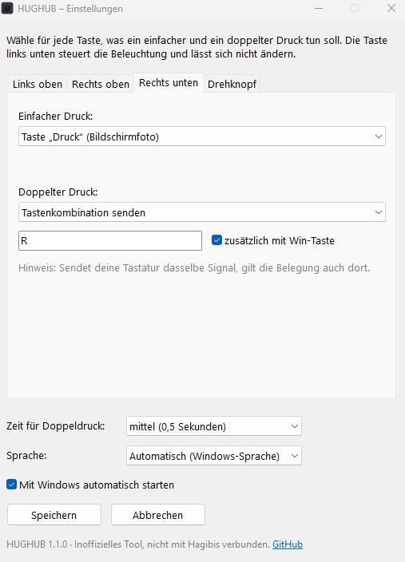

# Hubibis

\* Ja, noch ein Vibe-Coding-Projekt mehr auf GitHub. Aber vielleicht spart es jemandem Zeit und Token (Wasser & Energie), wenn er mein Tool nutzt, anstatt es neu zu coden.

\*\* Das Tool wurde unter Verwendung und Anleitung von Claude erstellt.

\*\*\* Ursprünglich hieß das Tool HUGHUB. Ich hatte vorher nicht geprüft, ob der Name schon vergeben ist, und er war es gleich mehrfach. Deshalb heißt es jetzt **Hubibis**. Die Adresse des Repositorys (`github.com/Irukandji-1337/hughub`) ist davon unberührt geblieben.

**Inoffizielles Tool zum Umbelegen der Tasten von Hagibis-1102AG-USB-C-Hubs**, die Software, die dein Hub nie bekommen hat.

**Hubibis** ist ein kleines, kostenloses Windows-Tool, mit dem ihr die Shortcut-Tasten und den Lautstärkeknopf des Hagibis USB-C-Hubs mit Drehknopf und Shortcut-Tasten (UC-1102AG) frei belegen könnt. Ohne Code, ohne Konfigurationsdateien: Du wählst einfach aus einer Liste, was jede Taste tun soll.

> **Inoffiziell.** Hubibis ist ein Fan-Projekt und steht in keiner Verbindung zu Hagibis, wird von Hagibis weder unterstützt noch empfohlen. „Hagibis“ ist eine Marke des jeweiligen Inhabers.

🇬🇧 [English version](README.md)



## Funktionen

- **Drei Tasten und den Knopfdruck umbelegen**: links oben, rechts oben, rechts unten und Druck auf den Drehknopf.
- **Einfacher und doppelter Druck**: Jede Taste kann zwei verschiedene Dinge tun. Die Zeit für den Doppeldruck ist einstellbar.
- **Viele Aktionen**: Tastenkombination senden, Programm, Datei oder Webseite öffnen, Text einfügen, Mediensteuerung (Play/Pause, nächster/vorheriger Titel), Spotify Play/Pause, PC sperren oder die Original-Funktion behalten.
- **Drehknopf-Modi**: Der Knopf lässt sich zwischen *Lautstärke* und einem zweiten Modus umschalten: in Videos spulen (YouTube & Co.), Titel wechseln oder scrollen. Im zweiten Modus kann ein Druck auf den Knopf das Video anhalten und fortsetzen.
- **Startet auf Wunsch mit Windows** und läuft unauffällig im Infobereich der Taskleiste.
- **Deutsch und Englisch**, automatisch passend zur Windows-Sprache.

Die Taste links unten (Beleuchtung) wird im Hub selbst verarbeitet und kommt nie beim PC an. Sie lässt sich deshalb nicht umbelegen.

## Download & Installation

1. `hubibis.exe` aus der [neuesten Version](https://github.com/Irukandji-1337/hughub/releases/latest) herunterladen.
2. In einen festen Ordner legen, zum Beispiel `Dokumente\Hubibis`. Der Autostart merkt sich diesen Ort.
3. Doppelklick. Das Einstellungsfenster öffnet sich, danach läuft das Tool im Infobereich der Taskleiste. Ein Klick auf das Symbol öffnet die Einstellungen wieder.

### Windows-Sicherheitswarnungen

`hubibis.exe` ist nicht digital signiert (ein Signaturzertifikat kostet Geld), deshalb behandelt Windows sie als unbekannte App. Je nach Einstellung erscheint eine dieser Meldungen:

- **SmartScreen: „Der Computer wurde durch Windows geschützt“**: Auf *Weitere Informationen* → *Trotzdem ausführen* klicken. Das ist nur einmal nötig.
- **Intelligente App-Steuerung (Smart App Control): „Ein Teil dieser App wurde blockiert“**: Die intelligente App-Steuerung blockiert unsignierte Apps komplett, ohne *Trotzdem ausführen*. Du hast zwei Möglichkeiten:
  - **Hubibis aus dem Quelltext starten** (siehe *Aus dem Quelltext starten* unten). AutoHotkey selbst ist signiert, deshalb klappt das in der Regel auch bei eingeschalteter App-Steuerung.
  - **Die intelligente App-Steuerung ausschalten**: *Windows-Sicherheit → App- und Browsersteuerung → Einstellungen für die intelligente App-Steuerung → Aus*. Seit dem Windows-Update vom April 2026 lässt sie sich dort jederzeit wieder einschalten. Bei älteren Windows-Versionen geht das Wiedereinschalten nur durch Zurücksetzen von Windows. Dann lieber den Quelltext-Weg nehmen.

Manche Virenscanner melden AutoHotkey-Tools außerdem, weil sie Tastendrücke abfangen. Das ist ein bekannter Fehlalarm, der komplette Quelltext liegt in diesem Repository.

## Autostart

Mit dem Häkchen *Mit Windows automatisch starten* im Einstellungsfenster startet Hubibis bei jeder Anmeldung von selbst. Je nachdem, ob Hubibis beim Speichern Administratorrechte hat, richtet es das auf eine von zwei Arten ein:

- **Mit Administratorrechten** (empfohlen, nötig für die Taste links oben): Hubibis legt in der Windows-Aufgabenplanung die Aufgabe *Hubibis* an. Sie startet das Tool etwa 10 Sekunden nach der Anmeldung mit Administratorrechten, ohne jedes Mal nachzufragen. **Solche Aufgaben erscheinen nicht im Task-Manager unter *Autostart-Apps*.** Du findest sie unter Win+R → `taskschd.msc` → *Aufgabenplanungsbibliothek* → *Hubibis*.
- **Ohne Administratorrechte**: Hubibis legt eine Verknüpfung im Autostart-Ordner an (Win+R → `shell:startup`). Diese erscheint im Task-Manager unter *Autostart-Apps*.

Wird `hubibis.exe` in einen anderen Ordner verschoben, aktualisiert Hubibis die Aufgabe beim nächsten Start mit Administratorrechten automatisch. Zum Ausschalten einfach das Häkchen entfernen und *Speichern* klicken. Hubibis entfernt Aufgabe bzw. Verknüpfung dann selbst.

## Die Taste links oben (Win+L)

Die Taste links oben sendet **Win+L**, und das verarbeitet Windows selbst, um den PC zu sperren. Um sie umzubelegen, muss Hubibis die Win+L-Sperre über die Registry abschalten, und das erlaubt Windows nur mit **Administratorrechten**. Wenn du diese Taste umbelegst, bietet das Tool an, sich mit Administratorrechten neu zu starten. Ist „Mit Windows automatisch starten“ aktiv, trägt es sich in die Aufgabenplanung ein und startet bei jeder Anmeldung mit diesen Rechten, ohne jedes Mal nachzufragen.

Gut zu wissen:

- Für Windows sind die Hub-Taste und Win+L auf deiner Tastatur identisch. Die Umbelegung gilt deshalb für beide. Mit der Aktion *PC sperren* (zum Beispiel auf einem Doppeldruck) kannst du trotzdem sperren.
- Beendest du Hubibis normal, wird Win+L wieder freigegeben. Wird das Tool hart beendet (etwa über den Task-Manager), bleibt Win+L abgeschaltet, bis Hubibis wieder gestartet und normal beendet wird.
- Programme und Webseiten, die das Tool öffnet, laufen trotzdem mit normalen Benutzerrechten.

## Kompatibilität

Getestet mit dem **Hagibis UC-1102AG** unter **Windows 11**. Andere Hagibis-Modelle mit Shortcut-Tasten senden eventuell andere Signale. Wenn deins nicht funktioniert, eröffne bitte ein [Issue](https://github.com/Irukandji-1337/hughub/issues) und gib an, was deine Tasten senden (siehe *Herausfinden, was deine Tasten senden* unten).

## Etwas funktioniert nicht?

Hubibis schreibt ein Log: Rechtsklick auf das Taskleistensymbol → *Log öffnen* (oder `%AppData%\Hubibis\hubibis.log` öffnen). Darin stehen jeder Start, jeder Tastendruck mit der ausgelösten Aktion, das Einrichten des Autostarts und alle Fehler. Bitte häng es an, wenn du ein [Issue](https://github.com/Irukandji-1337/hughub/issues) eröffnest.

Du findest das Taskleistensymbol nicht? Windows 11 versteckt neue Symbole hinter dem Pfeil ^. Dauerhaft sichtbar wird es unter *Einstellungen → Personalisierung → Taskleiste → Andere Taskleistensymbole*, dort Hubibis einschalten.

## Deinstallieren

1. Einstellungen öffnen, *Mit Windows automatisch starten* abhaken, die Taste links oben wieder auf *Original-Funktion* stellen und *Speichern* klicken.
2. Hubibis über das Taskleistensymbol beenden (Rechtsklick → *Beenden*).
3. `hubibis.exe` und den Ordner `%AppData%\Hubibis` löschen.

## Aus dem Quelltext starten

1. [AutoHotkey v2](https://www.autohotkey.com/) installieren.
2. `src/hubibis.ahk` und `src/hubibis.ico` in denselben Ordner herunterladen.
3. Doppelklick auf `hubibis.ahk`.

Um die exe selbst zu bauen: Rechtsklick auf `hubibis.ahk` → *Compile Script* (Ahk2Exe, als Basis v2 64-bit wählen). Name, Version und Symbol stehen in den Anweisungen am Anfang des Skripts.

## Herausfinden, was deine Tasten senden

Speichere das als `test.ahk`, starte es, drück deine Hub-Tasten, klick dann ins Fenster und drück F5:

```autohotkey
#Requires AutoHotkey v2.0
InstallKeybdHook
KeyHistory
Persistent
```

Der UC-1102AG sendet: links oben `Win+L`, rechts oben `Media_Play_Pause`, rechts unten `Win+PrintScreen`, Knopfdruck `Volume_Mute`, Drehen `Volume_Up` / `Volume_Down`.

## Lizenz

Hubibis steht unter der [MIT-Lizenz](LICENSE).

Die veröffentlichte `hubibis.exe` enthält den AutoHotkey-v2-Interpreter, der unter der GNU GPL v2 steht. Dessen Quelltext gibt es unter <https://github.com/AutoHotkey/AutoHotkey>.

Gemacht von [Irukandji-1337](https://github.com/Irukandji-1337).
