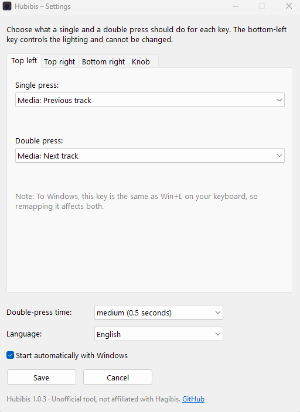

# Hubibis

\* Yes, yet another vibe-coding project on GitHub. But maybe it saves someone time and tokens (water & energy) to use my tool instead of coding it all over again.

\*\* This tool was created with the help and guidance of Claude.

\*\*\* This tool was originally called HUGHUB. I hadn't checked whether that name was already taken, and it turned out to be taken several times. So it's now called **Hubibis**. The repository address (`github.com/Irukandji-1337/hughub`) stayed the same.

**Unofficial key remapper for Hagibis 1102AG USB-C hubs** – the software your hub never shipped with.

**Hubibis** is a small, free Windows tool that lets you remap the shortcut keys and the volume knob of the Hagibis USB-C hub with knob and shortcut buttons (UC-1102AG). No code, no config files – just pick what each key should do from a list.

> **Unofficial.** Hubibis is a fan project and is not affiliated with, endorsed by or supported by Hagibis. “Hagibis” is a trademark of its owner.

🇩🇪 [Deutsche Anleitung](README.de.md)



## Features

- **Remap three keys and the knob press** – top left, top right, bottom right, and pressing the knob.
- **Single and double press** – every key can do two different things. The double-press time is adjustable.
- **Lots of actions** – send a key combination, open a program, file or website, insert text, media controls (play/pause, next/previous track), Spotify play/pause, lock the PC, or keep the original function.
- **Knob modes** – switch the knob between *volume* and a second mode: seek in videos (YouTube & co.), skip tracks or scroll. In the second mode, pressing the knob can pause/play your video.
- **Starts with Windows** if you want, and runs quietly in the system tray.
- **German and English**, picked automatically from your Windows language.

The bottom-left key (lighting) is handled inside the hub itself and never reaches the PC, so it can't be remapped.

## Download & installation

1. Download `hubibis.exe` from the [latest release](https://github.com/Irukandji-1337/hughub/releases/latest).
2. Put it in a permanent folder, e.g. `Documents\Hubibis` (autostart remembers this location).
3. Double-click it. The settings window opens; afterwards the tool lives in the system tray – click the icon to reopen the settings.

### Windows security warnings

`hubibis.exe` is not code-signed (a signing certificate costs money), so Windows treats it as an unknown app. Depending on your settings you will see one of these:

- **SmartScreen: “Windows protected your PC”** – click *More info* → *Run anyway*. You only need to do this once.
- **Smart App Control: “Part of this app has been blocked”** – Smart App Control blocks unsigned apps completely, without a *Run anyway* button. You have two options:
  - **Run Hubibis from source** (see *Run from source* below). AutoHotkey itself is signed, so this usually works with Smart App Control switched on.
  - **Switch Smart App Control off**: *Windows Security → App & browser control → Smart App Control settings → Off*. Since the April 2026 Windows update you can switch it back on there at any time. On older Windows versions, turning it back on requires resetting Windows – in that case, prefer running from source.

Some antivirus programs also flag AutoHotkey-based tools because they intercept key presses. That is a known false positive; the full source code is in this repository.

## Autostart

With *Start automatically with Windows* ticked in the settings window, Hubibis starts by itself every time you log on. Depending on whether Hubibis has administrator rights when you save, it sets this up in one of two ways:

- **With administrator rights** (recommended, needed for the top-left key): Hubibis creates the task *Hubibis* in the Windows Task Scheduler. It starts the tool about 10 seconds after logon with administrator rights, without asking every time. **Such tasks do not show up in Task Manager under *Startup apps*.** You find it via Win+R → `taskschd.msc` → *Task Scheduler Library* → *Hubibis*.
- **Without administrator rights**: Hubibis creates a shortcut in the Startup folder (Win+R → `shell:startup`). This one does show up in Task Manager under *Startup apps*.

If you move `hubibis.exe` to another folder, Hubibis updates the task automatically the next time it runs with administrator rights. To turn autostart off, untick the box and click *Save* – Hubibis removes the task or shortcut itself.

## The top-left key (Win+L)

The top-left key sends **Win+L**, which Windows handles itself to lock the PC. To remap it, Hubibis has to switch off the Win+L lock via the registry, and Windows only allows that with **administrator rights**. When you remap this key, the tool offers to restart itself as administrator. If “Start automatically with Windows” is enabled, it then registers itself in the Task Scheduler so it starts with these rights at every logon – without a prompt each time.

Good to know:

- To Windows, the hub key and Win+L on your keyboard are identical, so the remapping applies to both. Use the action *Lock PC* (e.g. on a double press) to still be able to lock.
- When you exit Hubibis normally, Win+L is enabled again. If the tool is killed (e.g. via Task Manager), Win+L stays disabled until Hubibis is started and exited again.
- Programs and websites opened by the tool still run with normal user rights.

## Compatibility

Tested with the **Hagibis UC-1102AG** on **Windows 11**. Other Hagibis models with shortcut keys may send different signals. If yours doesn't work, please [open an issue](https://github.com/Irukandji-1337/hughub/issues) and include what your keys send (see *Finding out what your keys send* below).

## Something not working?

Hubibis writes a log file: right-click the tray icon → *Open log* (or open `%AppData%\Hubibis\hubibis.log`). It records every start, every key press with the action it triggered, the autostart setup and all errors. Please attach it when you [open an issue](https://github.com/Irukandji-1337/hughub/issues).

If you can't find the tray icon: Windows 11 hides new icons behind the ^ arrow. To always show it, go to *Settings → Personalization → Taskbar → Other system tray icons* and switch on Hubibis.

## Uninstall

1. Open the settings, untick *Start automatically with Windows*, set the top-left key back to *Original function* and click *Save*.
2. Exit Hubibis via the tray icon (right-click → *Exit*).
3. Delete `hubibis.exe` and the folder `%AppData%\Hubibis`.

## Run from source

1. Install [AutoHotkey v2](https://www.autohotkey.com/).
2. Download `src/hubibis.ahk` and `src/hubibis.ico` into the same folder.
3. Double-click `hubibis.ahk`.

To build the exe yourself, right-click `hubibis.ahk` → *Compile Script* (Ahk2Exe, choose a v2 64-bit base). Name, version and icon are taken from the directives at the top of the script.

## Finding out what your keys send

Save this as `test.ahk`, run it, press your hub keys, then click the window and press F5:

```autohotkey
#Requires AutoHotkey v2.0
InstallKeybdHook
KeyHistory
Persistent
```

The UC-1102AG sends: top left `Win+L`, top right `Media_Play_Pause`, bottom right `Win+PrintScreen`, knob press `Volume_Mute`, knob turn `Volume_Up` / `Volume_Down`.

## License

Hubibis is released under the [MIT License](LICENSE).

The released `hubibis.exe` bundles the AutoHotkey v2 interpreter, which is licensed under the GNU GPL v2. Its source code is available at <https://github.com/AutoHotkey/AutoHotkey>.

Made by [Irukandji-1337](https://github.com/Irukandji-1337).
